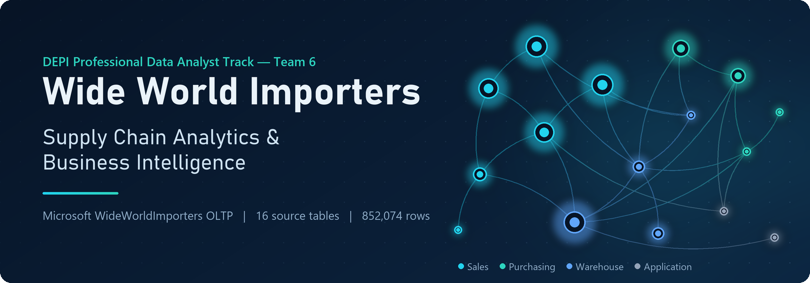
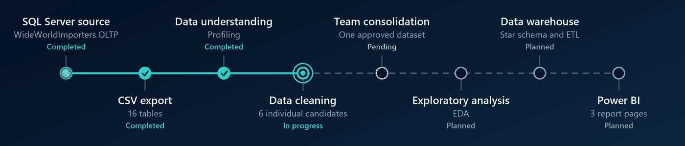
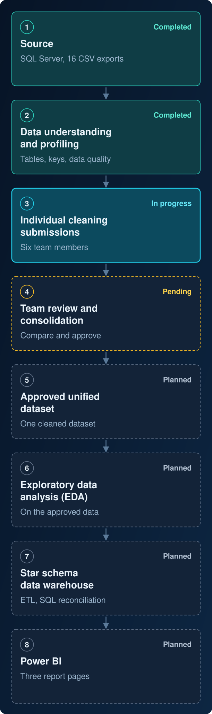

<div align="center">



<br>


**[Overview](#overview)** &nbsp;&nbsp;|&nbsp;&nbsp;
**[Dataset](#dataset)** &nbsp;&nbsp;|&nbsp;&nbsp;
**[Workflow](#analytics-workflow)** &nbsp;&nbsp;|&nbsp;&nbsp;
**[Progress](#current-progress)** &nbsp;&nbsp;|&nbsp;&nbsp;
**[Documentation](#documentation)** &nbsp;&nbsp;|&nbsp;&nbsp;
**[Team](#team)** &nbsp;&nbsp;|&nbsp;&nbsp;
**[Roadmap](#roadmap)**

</div>

> [!IMPORTANT]
> **Current milestone: individual data cleaning submissions, team consolidation pending.**
> Each of the six members is preparing an individual cleaning submission. One individual candidate has been completed and verified; the team has **not** yet approved a unified cleaned dataset. EDA, the data warehouse, ETL and Power BI have not started, so this repository contains no dashboards, KPIs or analytical findings.

<p align="center"></p>

## Overview

An end-to-end analytics and business intelligence project built on Microsoft's **Wide World Importers** sample: a wholesale distributor's sales, customers, inventory and purchasing. The project takes operational SQL Server data through profiling and validated cleaning, then into a custom dimensional model and Power BI reports.

## Business problem

Sales, customer, inventory and purchasing data live in separate operational tables, each with its own grain, status codes and history. Answering basic management questions consistently (revenue and profit by customer or product, stock movement, supplier purchasing) needs clear metric definitions and data whose quality has been checked. Reports built straight on the operational tables can double-count, mix grains or hide data-quality issues.

## Objectives

| | Objective |
|:-:|---|
| **1** | Understand the source tables, relationships, business rules and data quality. |
| **2** | Produce clean, validated, reproducible datasets without inventing or deleting data. |
| **3** | Design a custom dimensional (star schema) model for selected KPIs. |
| **4** | Build repeatable ETL with validation and logging. |
| **5** | Deliver three Power BI report pages (Executive Overview, Sales & Customers, Inventory & Purchasing) with KPIs reconciled against SQL. |

Full scope: [Project Proposal](01_Project_Planning_and_Documentation/1_Project_Planning_and_Management/01_Project_Proposal.docx).

## Technology stack

<p>


</p>

| Area | Tools |
|---|---|
| Source database | Microsoft SQL Server (Express), SSMS, T-SQL (read-only queries) |
| Data preparation | Python 3.14, pandas 3.0, pyodbc, Jupyter |
| Validation | Python `unittest`, standard-library verifiers, read-only SQL reconciliation |
| Planned modeling and reporting | Custom star schema in SQL Server, Power BI Desktop, Power Query, DAX |
| Collaboration | GitHub |

<p align="center"></p>

## Dataset

**Source:** the SQL Server database **`WideWorldImporters`**, the full OLTP sample. The separate `WideWorldImportersDW` warehouse sample is used only as a design reference. Microsoft's data is synthetic and historical (2013 to May 2016), so any finding describes the sample, not a real company.

**Exported:** 16 tables, **852,074 rows** and **139 columns**, as CSV files in [`00_Source_Data/CSV_Exports/`](00_Source_Data/CSV_Exports/). The export was checked against SQL Server; see the [export QA report](00_Source_Data/CSV_Exports/CSV_Export_QA_Report.html).

| Schema | Table (rows) |
|---|---|
| **Sales** | Orders (73,595), OrderLines (231,412), Invoices (70,510), InvoiceLines (228,265), Customers (663), CustomerCategories (8) |
| **Purchasing** | PurchaseOrders (2,074), PurchaseOrderLines (8,367), Suppliers (13), SupplierCategories (9) |
| **Warehouse** | StockItems (227), StockItemHoldings (227), StockItemTransactions (236,667), PackageTypes (14) |
| **Application** | TransactionTypes (13), DeliveryMethods (10) |

**Format:** UTF-8 with BOM, every field quoted, `\N` for SQL NULL. Load the files as the [Data Dictionary](00_Source_Data/CSV_Exports/Data_Dictionary.md) describes; default `pd.read_csv` settings misread NULLs and money values. Personal-data tables such as `Application.People` were deliberately not exported.

The full database backup is available from the [official Microsoft release](https://github.com/microsoft/sql-server-samples/releases/tag/wide-world-importers-v1.0) (`WideWorldImporters-Full.bak`).

## Analytics workflow

<p align="center">

</p>

<picture>
  <source media="(min-width: 768px)" srcset="assets/readme/workflow-diagram.svg">
  
</picture>

<p align="center"><sub>Project workflow from source data to analytics and BI deliverables. <a href="docs/workflow-diagram.md">Mermaid source</a>.</sub></p>

<p align="center"></p>

## Current progress

| Phase | Status | Notes |
|---|:-:|---|
| Project Planning & Management |  | [Proposal, plan and team roles](01_Project_Planning_and_Documentation/1_Project_Planning_and_Management/) |
| Literature Review |  | [Literature and lecturer review](01_Project_Planning_and_Documentation/2_Literature_Review/). No written instructor evaluation has been received yet. |
| Requirements Gathering |  | [Requirements documentation](01_Project_Planning_and_Documentation/3_Requirements_Gathering/) |
| Database restore and CSV export |  | 16 tables, checked against SQL Server |
| Data understanding and profiling |  | Notebooks are being finalized and will be uploaded later. |
| Individual data cleaning |  | All six members clean the full 16-table scope independently. One candidate is completed and verified; the others are in preparation. |
| Team comparison and consolidation |  | No unified cleaning approach or cleaned dataset has been approved. |
| EDA, data warehouse, ETL, Power BI |  | Begins after the unified dataset is approved. |
| Testing, final report, presentation |  | Final submission due 4 Dec 2026. |

### How the cleaning submissions are consolidated

The team will compare each member's documented data scope, cleaning decisions, reproducible code and before/after validation. Conflicting decisions and open business questions are reviewed before one dataset is approved. Raw source files stay unchanged. Official cleaned datasets, notebooks, code and reports will be published here only after that review.

## Documentation

| Document | Section | Link |
|---|---|---|
| Project Proposal | Planning & Management | [01_Project_Proposal.docx](01_Project_Planning_and_Documentation/1_Project_Planning_and_Management/01_Project_Proposal.docx) |
| Project Planning | Planning & Management | [02_Project_Planning.docx](01_Project_Planning_and_Documentation/1_Project_Planning_and_Management/02_Project_Planning.docx) |
| Team Roles | Planning & Management | [03_Team_Roles.docx](01_Project_Planning_and_Documentation/1_Project_Planning_and_Management/03_Team_Roles.docx) |
| Literature and Lecturer Review | Literature Review | [05_Literature_and_Lecturer_Review.docx](01_Project_Planning_and_Documentation/2_Literature_Review/05_Literature_and_Lecturer_Review.docx) |
| Requirements Gathering | Requirements | [04_Requirements_Gathering.docx](01_Project_Planning_and_Documentation/3_Requirements_Gathering/04_Requirements_Gathering.docx) |
| Data Dictionary (14 tables) | Source data | [Data_Dictionary.md](00_Source_Data/CSV_Exports/Data_Dictionary.md) |
| Customer export addendum (2 tables) | Source data | [Customer_Export_Addendum.md](00_Source_Data/CSV_Exports/Customer_Export_Addendum.md) |
| CSV export QA report | Source data | [CSV_Export_QA_Report.html](00_Source_Data/CSV_Exports/CSV_Export_QA_Report.html) |

<sub>GitHub cannot preview `.docx` files; use the download button on each file page.</sub>

## Repository structure

```text
NHA-5-272/
├── README.md                                  project overview and current status
├── assets/                                    README banner, workflow animation, divider
│   └── readme/                                static workflow diagrams (desktop and mobile)
├── docs/                                      workflow diagram source (Mermaid)
├── 00_Source_Data/
│   ├── README.md                              source notes and backup download
│   └── CSV_Exports/                           16 raw CSVs, data dictionary, addendum, export QA
└── 01_Project_Planning_and_Documentation/
    ├── README.md                              section index
    ├── 1_Project_Planning_and_Management/     proposal, planning, team roles
    ├── 2_Literature_Review/                   literature and lecturer review
    └── 3_Requirements_Gathering/              requirements documentation
```

<p align="center"></p>

## Team

DEPI Professional Data Analyst Track, Team 6.

| Member | Role |
|---|---|
| Omar Mahmoud Sophy Rezk | Team Leader & Project Integration |
| Ahmed Saleh Abdelzaher | Data Engineering & ETL |
| Sara Mostafa Abdelhafiz | Data Analysis & Data Quality |
| Abdelrahman Mohammed Fathy | SQL & Data Warehouse |
| Samir Magdy Yacoub | Power BI & DAX |
| Ola Abdelkader Mahmoud Mohamed | Business Analysis & Documentation |

## Roadmap

1. Compare the six cleaning submissions and approve one unified dataset.
2. Exploratory data analysis on the approved dataset.
3. System analysis and design: star schema, ERD, data flow and ETL design (due 6 Nov 2026).
4. ETL into a custom data warehouse, with SQL reconciliation tests.
5. Power BI: three report pages with validated KPIs.
6. Testing, final report and presentation (due 4 Dec 2026).

## Not included yet

- **Jupyter notebooks.** Data understanding and profiling notebooks are being finalized and will be uploaded later. Cleaning notebooks need team review and approval first.
- **Cleaning code, candidate cleaned datasets and reports.** Held back until the team approves a unified implementation.
- **SQL Server backups** (`.bak`, 54 to 127 MB each). They are Microsoft's public files; see the release link under [Dataset](#dataset).
- Personal study guides, archived drafts, local environments and temporary files.

<div align="center">
<br>
<sub>DEPI (Digital Egypt Pioneers Initiative) graduation project. Data: Microsoft Wide World Importers sample database.</sub>
</div>
