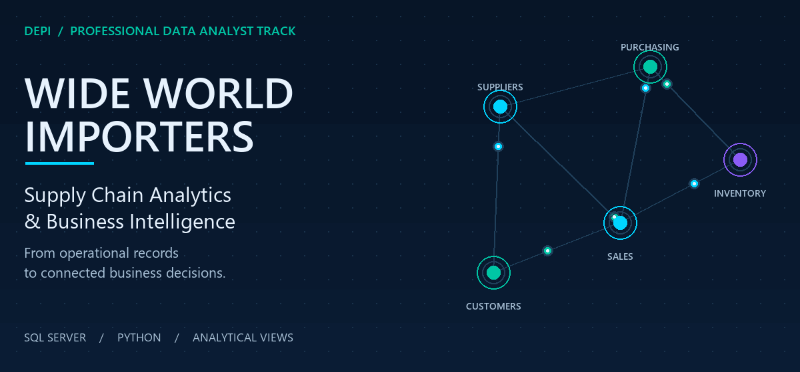
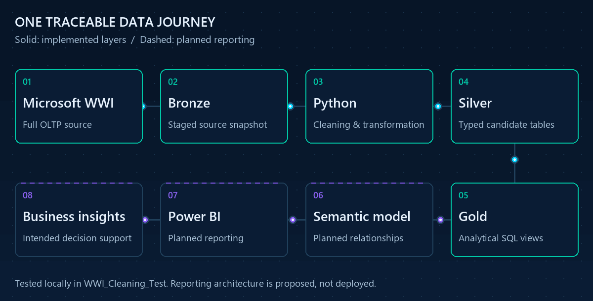
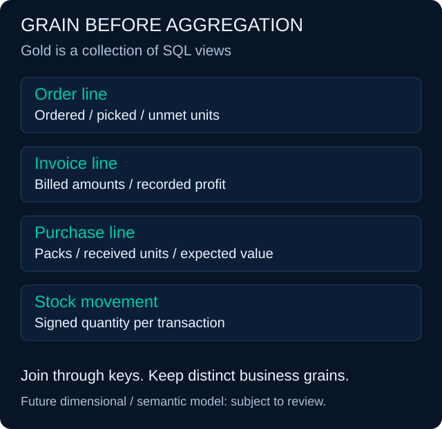
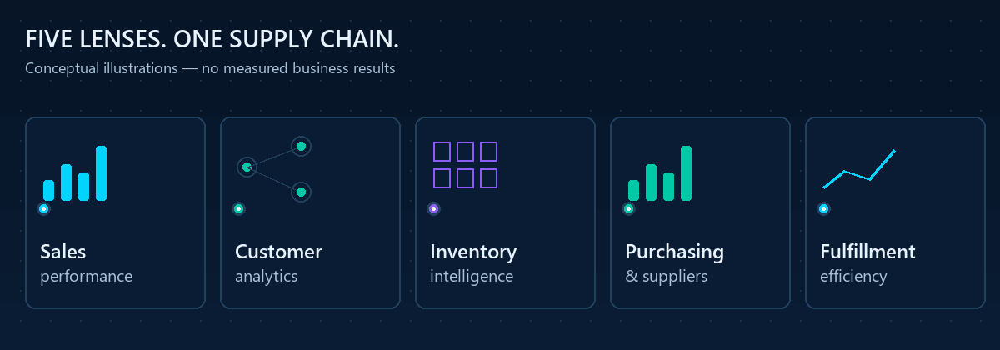
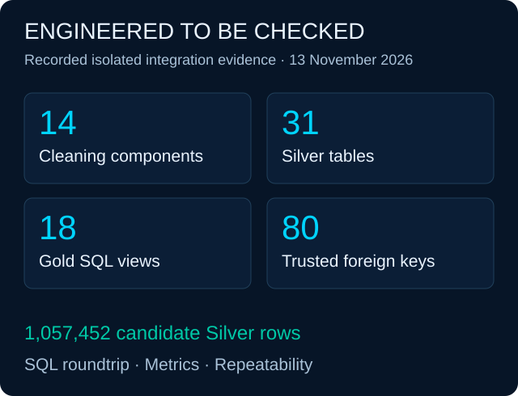

<picture>
  <source media="(prefers-reduced-motion: reduce) and (max-width: 680px)" srcset="assets/readme/hero-mobile.png">
  <source media="(prefers-reduced-motion: reduce)" srcset="assets/readme/hero.png">
  <source media="(max-width: 680px)" srcset="assets/readme/hero-mobile.gif">
  
</picture>

# Wide World Importers

### Supply Chain Analytics & Business Intelligence

An end-to-end analytical solution for understanding **demand, purchasing, inventory and fulfillment**. Built on Microsoft's wholesale-distribution sample, the project connects SQL Server data engineering, business-aware Python transformations and analytical SQL views—with Power BI as the planned reporting layer.

**Preserve the source. Make transformations traceable. Build decisions on validated data.**

[Architecture](#data-architecture) · [Dataset](#source-data) · [Analytics](#analytics-domains) · [Validation](#technical-validation) · [Documentation](#project-documentation) · [Team](#project-team)

[**Read the system design →**](01_Project_Planning_and_Documentation/4_System_Analysis_and_Design/04_System_Analysis_and_Design.pdf) &nbsp; [Explore the source exports](00_Source_Data/CSV_Exports/)

---

## The business challenge

A customer order, a supplier receipt and a stock movement tell different parts of the same story. Bringing them together requires more than joining tables: quantities use different units, events happen on different dates, and historical movements do not automatically explain today's stock balance.

| Business question | Analytical approach |
|---|---|
| What is driving customer demand? | Separate ordered demand from invoiced sales; examine products, customers and categories. |
| Where could fulfillment improve? | Compare ordered, picked and unmet quantities at the correct line grain. |
| How should inventory decisions be informed? | Combine current holdings, replenishment settings and signed movements without inventing opening balances. |
| How does purchasing support availability? | Compare ordered and received packs, supplier activity and expected purchase values. |

The solution is designed to support these decisions through a reproducible path from operational records to clearly defined measures. Business questions guide the model; technical tests establish whether its outputs can be trusted.

## Data architecture

<picture>
  <source media="(prefers-reduced-motion: reduce) and (max-width: 680px)" srcset="assets/readme/architecture-mobile.png">
  <source media="(prefers-reduced-motion: reduce)" srcset="assets/readme/architecture.png">
  <source media="(max-width: 680px)" srcset="assets/readme/architecture-mobile.gif">
  
</picture>

**Bronze → Python → Silver → Gold** is the implemented analytical foundation. An isolated restored warehouse snapshot supports the validated integration test; it is not a production deployment or proof that source extraction has been replayed end to end.

| Layer | Responsibility |
|---|---|
| **Bronze** | Preserve staged operational records. The restored warehouse contains 48 tables: 31 current and 17 historical/archive objects. |
| **Python transformation** | Apply explicit types, justified corrections and business-rule checks through 14 cleaning components. |
| **Silver** | Maintain 31 typed relational outputs with primary/composite keys and tested foreign-key constraints. |
| **Gold** | Expose 18 SQL views for analytical joins and measures—not 18 physical fact or dimension tables. |
| **Semantic modeling & Power BI** | Planned relationships, measures and reporting experiences, subject to business-definition and model review. |

The controlled test uses `candidate_silver`, `candidate_gold` and `candidate_evidence` in **`WWI_Cleaning_Test`**, retaining the restored Silver/Gold baseline for comparison. Original OLTP and reference databases remain protected.

## Source data

**Microsoft WideWorldImporters Full OLTP** models a wholesale distributor. The separate `WideWorldImportersDW` sample is not the operational source. This is synthetic historical data; the transaction sample covers 2013–May 2016, with an incomplete final year.

The published CSV reference contains **16 tables and 852,074 rows**. The wider warehouse test contains **31 Silver tables and 1,057,452 rows**. These are different scopes and grains, not competing counts of the same dataset.

| Published source domain | Tables |
|---|---|
| Sales | Orders, OrderLines, Invoices, InvoiceLines, Customers, CustomerCategories |
| Purchasing | Suppliers, SupplierCategories, PurchaseOrders, PurchaseOrderLines |
| Warehouse | StockItems, StockItemHoldings, StockItemTransactions, PackageTypes |
| Application | TransactionTypes, DeliveryMethods |

[**Browse the 16 CSVs**](00_Source_Data/CSV_Exports/) · [Data Dictionary](00_Source_Data/CSV_Exports/Data_Dictionary.md) · [Customer reference addendum](00_Source_Data/CSV_Exports/Customer_Export_Addendum.md) · [Export QA](00_Source_Data/CSV_Exports/CSV_Export_QA_Report.html)

<details>
<summary><strong>Read the exports without losing source meaning</strong></summary>

Files use UTF-8 with BOM, quoted fields and `\N` for SQL NULL. Preserve identifiers and decimal text during initial loading:

```python
import pandas as pd

orders = pd.read_csv(
    "00_Source_Data/CSV_Exports/Sales_Orders.csv",
    encoding="utf-8-sig",
    dtype="string",
    keep_default_na=False,
    na_values=[r"\N"],
)
```

Convert dates and analytical quantities explicitly. Use exact decimal handling for financial calculations. An empty string is not the same as SQL NULL.

The original `WideWorldImporters-Full.bak` is available from the [official Microsoft release](https://github.com/microsoft/sql-server-samples/releases/tag/wide-world-importers-v1.0). See the [source notes](00_Source_Data/README.md) before restoring into your own isolated environment.

</details>

## Cleaning and transformation

**Correct evidence-backed defects; preserve legitimate business exceptions.** The candidate separates raw inputs, transformed outputs and validation evidence. It does not treat every NULL, negative value or statistical outlier as corruption.

- **Exact types:** Python `Decimal`, declared SQL decimal types and lossless handling of temporal values, including year-9999 sentinels.
- **Correct relationships:** validate customer buying groups against BuyingGroups; retain composite keys where the relationship requires them.
- **Financial meaning:** unmatched supplier-invoice amounts remain unknown rather than becoming fabricated zeros.
- **Source preservation:** eight invoice fields outside the Silver projection remain in keyed evidence; they are not silently discarded.
- **Controlled loading:** explicit schemas, parameterized loading, transactional checks and guarded writes preserve the baseline. No automatic table replacement.

Negative-profit invoice lines, missing picker identifiers and historical invoice delays are preserved where corrections lack defensible evidence. **227 inventory reconciliation discrepancies remain business questions**, not repaired balances. Final scope and consolidated business rules require collective agreement.

## Gold analytical model

<p align="center"></p>

The Gold layer connects transaction views with product, customer, supplier and geographic context. Important views include `vw_OrderLine`, `vw_InvoiceLine`, `vw_PurchaseLine`, `vw_ItemMaster`, `vw_StockMovement` and the customer/supplier ledgers.

**Modeling rules that protect the answer:**

- Aggregate invoice-level delivery measures at invoice grain, not once per invoice line.
- Distinguish purchasing outer packs from individual sales units.
- Treat expected purchase values separately from actual supplier expenditure.
- Treat holdings as a snapshot, not historical daily inventory.
- Check cardinality before expanding stock-group relationships or combining fact-like views.

The tested SQL views provide a foundation for a future dimensional and Power BI semantic model. They do not, by themselves, establish an approved star or galaxy schema. [Explore the ERD and physical contracts →](01_Project_Planning_and_Documentation/4_System_Analysis_and_Design/04_System_Analysis_and_Design.pdf)

## Analytics domains

<picture>
  <source media="(prefers-reduced-motion: reduce) and (max-width: 680px)" srcset="assets/readme/domains-mobile.png">
  <source media="(prefers-reduced-motion: reduce)" srcset="assets/readme/domains.png">
  <source media="(max-width: 680px)" srcset="assets/readme/domains-mobile.gif">
  
</picture>

The intended reporting experience brings these domains into three Power BI pages: **Executive Overview**, **Sales & Customers**, and **Inventory & Purchasing**. Planned measures cover billed sales, recorded profit, demand, fulfillment and stock availability, with explicit units and date definitions.

The illustrations above express analytical themes, not completed dashboards or measured business findings. Power BI remains the planned presentation layer.

## Technology stack

| Foundation | Tools and purpose |
|---|---|
| **SQL Server · T-SQL** | Operational source, Bronze/Silver tables, Gold views, typed contracts and reconciliation queries |
| **Python · pandas · Decimal** | Reproducible transformations, data-quality checks and exact financial arithmetic |
| **Jupyter · pyodbc** | Inspectable analytical work and Windows-authenticated SQL connectivity |
| **ETL · automated tests** | Controlled loading, keyed readback, repeatability and baseline preservation |
| **Git · GitHub** | Versioned documentation, review and official submission |
| **Power BI · Power Query · DAX** | Planned semantic modeling, measures and interactive reporting |

## Technical validation

<p align="center"></p>

The isolated integration was committed locally on **11 November 2026**, with independent verification of persisted results on **13 November 2026**. Recorded checks passed for:

- Exact SQL roundtrip reconciliation across all 31 candidate Silver outputs.
- Primary/composite keys and 80 enabled, trusted foreign keys.
- Execution of all 18 candidate Gold views and selected financial/quantity reconciliations.
- Deterministic transformation results, repeat-load behavior and baseline preservation.

These results establish technical consistency for the tested snapshot—not production readiness or final approval of KPI meaning. The [System Analysis & Design submission](01_Project_Planning_and_Documentation/4_System_Analysis_and_Design/04_System_Analysis_and_Design.pdf) records the evidence, architecture and limitations.

<details>
<summary><strong>Interpretation boundaries</strong></summary>

The proposed source-scope expansion and unified cleaned dataset require team agreement. Inventory discrepancies and unmatched supplier-invoice interpretations remain open. Relationships outside the tested projection, incomplete cold-room history, full sequential notebook replay, source extraction replay and production/incremental deployment are not covered by the successful candidate test. Matching arithmetic does not establish business validity.

</details>

## Project documentation

| Explore | Published deliverables |
|---|---|
| **01 · Direction** | [Project Proposal](01_Project_Planning_and_Documentation/1_Project_Planning_and_Management/01_Project_Proposal.docx) / [Project Planning](01_Project_Planning_and_Documentation/1_Project_Planning_and_Management/02_Project_Planning.docx) / [Team Roles](01_Project_Planning_and_Documentation/1_Project_Planning_and_Management/03_Team_Roles.docx) |
| **02 · Research** | [Literature & Lecturer Review](01_Project_Planning_and_Documentation/2_Literature_Review/05_Literature_and_Lecturer_Review.docx) |
| **03 · Requirements** | [Requirements Gathering](01_Project_Planning_and_Documentation/3_Requirements_Gathering/04_Requirements_Gathering.docx) |
| **04 · System design** | [Read the PDF](01_Project_Planning_and_Documentation/4_System_Analysis_and_Design/04_System_Analysis_and_Design.pdf) / [Editable Word document](01_Project_Planning_and_Documentation/4_System_Analysis_and_Design/04_System_Analysis_and_Design.docx) |

Download Word files to view or edit them. The design PDF provides a readable entry point for technical reviewers.

### Repository guide

This official submission repository publishes **source exports and documentation**. The wider implementation and test evidence are maintained in the unified local working project; this page does not imply that its Python, SQL, notebooks or candidate datasets are already published here.

| Location | Contents |
|---|---|
| [`00_Source_Data/`](00_Source_Data/) | Source notes, 16 CSV exports, dictionary and export QA |
| [`01_Project_Planning_and_Documentation/`](01_Project_Planning_and_Documentation/) | Four documentation sections and editable submissions |
| [`assets/readme/`](assets/readme/) | Original animated and static presentation graphics |

## Project team

Six members in the **Digital Egypt Pioneers Initiative — Professional Data Analyst Track**. The roles below follow the submitted team documentation.

| Member | Documented responsibility |
|---|---|
| **Omar Mahmoud Sophy Rezk** | Team Leadership & Project Integration |
| **Ahmed Saleh Abdelzaher** | Data Engineering & ETL |
| **Sara Mostafa Abdelhafiz** | Data Analysis & Data Quality |
| **Abdelrahman Mohammed Fathy** | SQL & Data Warehouse |
| **Samir Magdy Yacoub** | Power BI & DAX |
| **Ola Abdelkader Mahmoud Mohamed** | Business Analysis & Documentation |

## References and acknowledgments

- [Microsoft SQL Server Samples](https://github.com/microsoft/sql-server-samples) — original Wide World Importers dataset and source attribution.
- [Wide World Importers release](https://github.com/microsoft/sql-server-samples/releases/tag/wide-world-importers-v1.0) — original database backups.
- DEPI documentation guidelines and the submitted [literature review](01_Project_Planning_and_Documentation/2_Literature_Review/05_Literature_and_Lecturer_Review.docx) — academic context and design references.

All README illustrations are original project graphics. Static alternatives are supplied for reduced-motion preferences and direct viewing: [hero](assets/readme/hero.png), [architecture](assets/readme/architecture.png), [analytics domains](assets/readme/domains.png). [Visual sources and reproduction notes](docs/workflow-diagram.md).

---

**Operational detail → trustworthy data → informed supply-chain decisions.**
