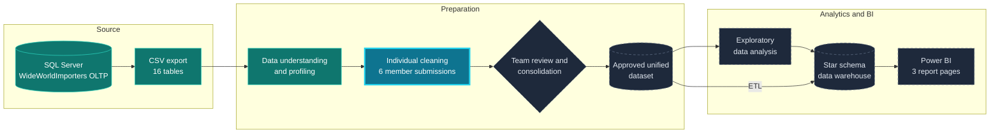

# Workflow diagram source (Mermaid)

This is the original Mermaid version of the project workflow, kept for reference and editing. The main [README](../README.md) shows static SVG versions instead (`assets/readme/workflow-diagram.svg` and `workflow-diagram-mobile.svg`), because Mermaid does not render in every GitHub view, notably on mobile.

Teal: completed. Cyan: in progress. Dashed: pending or planned.
